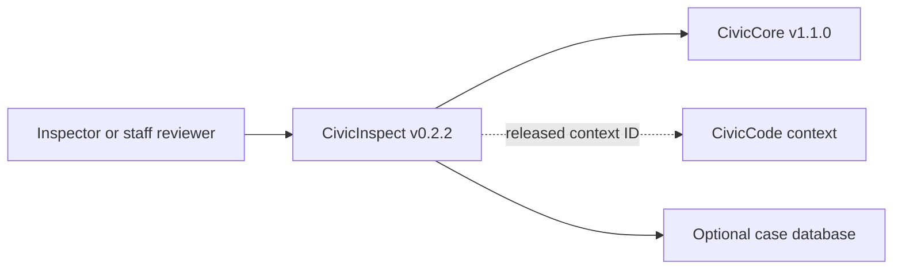

# Townlight Inspections — User manual

Current operating guide · reviewed 2026-10-26 · Signed Inspections 1.7.0-beta.1.

[Product page](https://townlight.github.io/products/inspections/) · [Overall manual](https://github.com/townlight/townlight/blob/main/USER-MANUAL.md) · [Requirements assessment](https://github.com/townlight/townlight/blob/main/docs/assessment/feature-and-integration-review.md)

## Purpose and audience

Inspections organizes inspector-supplied evidence and report/notice drafts. Inspectors own observations and official decisions; the accepted workflow neither analyzes photos with AI nor initiates enforcement.

Primary operators: **Inspectors and authorized reviewing staff**. [Release and acceptance notes](https://github.com/townlight/townlight/releases/tag/townlight-records-meetings-code-zoning-planning-permitting-inspections-v1.7.0-beta.1).

## Before starting

Use the explicit product composition in the installed Townlight desktop. Sign in with the required local staff account, confirm System Health readiness and take a backup before maintenance. If a workspace is absent, inspect the profile and release identity before importing data. Optional AI is not needed for the accepted deterministic workflow. The procedures below use real saved sources; sample/demo web pages are not substitutes.

## Complete the workflow

### 1. Enable the composition

Use the signed 1.7 release and explicitly select the Inspections staff composition in Settings. Its separate installed product is Townlight Inspections Candidate. Retain existing Planning/Permitting installations and profiles; this is not a reason to remove their evidence.

### 2. Capture the case and originals

Create the case with property context and inspector notes. Import the original field files through the supported controls and inspect filename/hash/provenance. Enter the observations yourself. A photo file or supplied voice-note summary is evidence, not proof that automatic image or speech analysis occurred.

### 3. Select Code

Search permitted Code sources and select the exact public citation/version. Inspect applicability yourself. Do not accept invented authority or let a draft turn an informational citation into an official enforcement finding.

### 4. Save and reopen

Save the draft, reopen the same case and confirm retained originals, notes and selected source. Inspect related saved case context where relevant; sample repeat-case endpoints are not a live enforcement-system mirror.

### 5. Record staff review

Review the report/notice draft and enter review notes. Record staff review explicitly. The server derives reviewer identity and history. Any later edits require a new draft/review; a packet is tied to the reviewed revision.

### 6. Prepare the correct audience

Preview the private packet for staff. Separately edit and review a public summary before preparing the Records copy. Inspect that private observations, personal details and private notes are excluded according to the public-copy contract. Keep original files in their source record.

### 7. Attach and navigate to Records

Attach the exact reviewed copy to an existing Records request, then open Records and inspect that same attachment/hash. Navigation refreshes canonical Records state. Attachment does not approve, fulfill or release the request; leave the city’s enforcement action in its official system.

## How this product connects

Inspections consumes Core and cited Code, and supplies an explicit Records copy. A direct automated Permitting-to-Inspections handoff is not an accepted workflow.

## Boundaries and known gaps

Live photo analysis, automatic audio transcription, live LLM analysis, official citations/fines, scheduling and enforcement-system writeback are outside the accepted implementation. Inspector-supplied photo observations/voice summaries must not be advertised as automated photo/voice-to-report processing.

## Shared operating rules

Use the installed native desktop for the accepted workflow. Standalone package web pages, sample endpoints and developer API examples are different surfaces. A local Resident/Public view is not an internet deployment. Confirm the selected composition before looking for a workspace.

1. Keep named staff accounts and least privilege. Administrators manage setup; ordinary staff use their authorized workspace. Do not put credentials, unredacted evidence or resident data into public issues.
2. Preserve originals and their hashes. Import preview and confirmation are distinct actions. Treat fictional fixtures as fictional; they are not municipal authority.
3. Save before navigating away, closing or signing out. Unsaved drafts are not a durable record. On a conflict, reopen and reconcile; on an unknown result, inspect the saved record before repeating a write.
4. Review the exact revision and audience. A private packet and a public copy are different artifacts. Public text is explicitly edited/reviewed; changing a filename does not sanitize private content.
5. Keep source permission, version and hash checks. If a provider is stopped or a source becomes restricted, retain the draft, restore authorized access and deliberately reselect evidence. Never bypass the check or substitute a sample.
6. Approval, attachment, export and publication are separate actions. No cross-product attachment is an automatic records response, official permit, legal determination or enforcement decision.

## Installation, maintenance and recovery

Choose a release from the overall manual; do not infer a supported upgrade from a higher version number. Verify its published checksum, publisher signature and acceptance notes before installing. The default download remains the signed 1.4 beta, and Records-only remains its default selection. Planning 1.5.1 has a fresh-install boundary; Permitting and Inspections use separately identified products.

Complete Setup and normal runtime activation for the selected composition. Optional local AI can be deferred. Use System Health to distinguish stopped, starting, ready and failed dependencies. Wait for readiness before opening a dependent workspace. Use documented Retry controls after recovery; do not repeat business writes to refresh a stale screen.

Back up through the canonical desktop controls before migration or maintenance. Keep the coherent data, document and profile backup and its receipt in protected storage. A source export is not a full backup. Stop dependent services before PostgreSQL maintenance. Restore through the supported controls rather than editing SQL or restoring historical JSON into the active runtime. Uninstall can retain data; backup before uninstalling and inspect the chosen removal options. Never assume uninstall means data deletion.

For an error, retain the message, time, selected profile, installed version and operation; inspect System Health and relevant logs. Use a redacted support bundle. Do not delete the profile, run an arbitrary downgrade or repair prerequisites as a first response. If an installer requests a restart, save work and obtain the operator’s explicit restart decision before proceeding.

## Evidence and scope

This manual reuses the accepted installed, required-CI and signed-delivery evidence. It does not turn source inspection into a new installed test. Recovery evidence is reused only within its recorded candidate/profile boundaries; no universal upgrade, hardware, accessibility or production deployment certification is implied. The [overall manual](https://github.com/townlight/townlight/blob/main/USER-MANUAL.md) gives release identities and shared operations. The [feature and integration assessment](https://github.com/townlight/townlight/blob/main/docs/assessment/feature-and-integration-review.md) separates implementation, explicit deferral, missing capability and unverified acceptance.

## Maintainer and API reference

The following source contracts support these instructions. The historical reference below retains older API/setup details for their original version; it does not override this operating guide or the release acceptance.

- [civicinspect/report_draft.py](https://github.com/townlight/inspect/tree/main/civicinspect/report_draft.py)
- [civicinspect/workflow_models.py](https://github.com/townlight/inspect/tree/main/civicinspect/workflow_models.py)
- [civicinspect/workflow_store.py](https://github.com/townlight/inspect/tree/main/civicinspect/workflow_store.py)
- [civicinspect/connections.py](https://github.com/townlight/inspect/tree/main/civicinspect/connections.py)
- [civicinspect/records_export.py](https://github.com/townlight/inspect/tree/main/civicinspect/records_export.py)
- [civicinspect/main.py](https://github.com/townlight/inspect/tree/main/civicinspect/main.py)

---

## Historical package/API reference

The material below is retained from the previous manual for historical and developer reference. Version, unreleased, sample, planned and installation claims below describe that earlier document, not current desktop release status. Use the current guide above for operation. Existing detailed API reference remains useful only for the matching package/version.

# Townlight Inspections User Manual

Townlight Inspections helps inspection staff turn field notes into review-ready inspection drafts while preserving staff control over every decision.

Current state: Townlight Inspections v0.2.2 corrective demotion state. This narrow truth-repair release is no functional upgrade; it exists solely to supersede the false v1.0.0 release from 2026-05-21 in GitHub's Latest impression, with the Townlight Core pin unchanged. The module includes deterministic sample checks, optional database-backed repeat-case and report-draft records, staff review queue workflows, review-required CivicCode/case context packet support, adversarial local integration mocks, Townlight Core v1.1.0 release-wheel alignment, and a public sample UI at `/civicinspect`.

## Runtime Surface

Townlight Inspections is a FastAPI Python package pinned to the published `civiccore v1.1.0` release wheel. The runtime exposes:

- repeat-case lookup,
- inspector-owned report draft creation,
- persisted report retrieval when a case database is configured,
- staff-only review queue create/list/update/summary routes,
- review-required CivicCode/case context packets,
- adversarial local integration mocks,
- notice draft helpers,
- records-ready export checklists,
- public sample UI.

## Staff Configuration

Set `CIVICINSPECT_CASE_DB_URL` to persist repeat-case, report-draft, and staff queue records. Set `CIVICINSPECT_STAFF_API_KEY` before using staff-only queue routes. Staff routes require:

- `X-CivicInspect-Role: staff`
- `X-CivicInspect-Staff-Key: <configured key>`

This local API-key gate is a release safeguard, not a replacement for production identity, tenant scoping, and audit logging.

## Product Boundary

Townlight Inspections does not issue official findings, citations, fines, notices, inspection schedules, legal advice, live photo analysis, live LLM calls, or system-of-record updates.

## Architecture

Townlight Inspections depends on Townlight Core. Townlight Core does not depend on Townlight Inspections. Townlight Inspections v0.2.2 uses deterministic sample data plus optional staff-gated persistence, review-required context packets for released Townlight Code references, staff review queue records, and adversarial local mocks for integration-depth validation.

## Connected candidate 0.3.0+dev.1

Connected desktop candidate 0.3.0+dev.1 adds migrated inspection revisions, original evidence hashes, actual saved repeat cases, public Code citations, server-attributed staff review and private/report versus separately edited Records-copy packets. Native staff authentication and the desktop inspections-preview profile are required. This is source work awaiting required CI and installed acceptance, not a published release. The standalone sample UI and historical 0.2.2 evidence remain unchanged. No official notice issuance, citation, fine, scheduling, image analysis or transcription is added.
