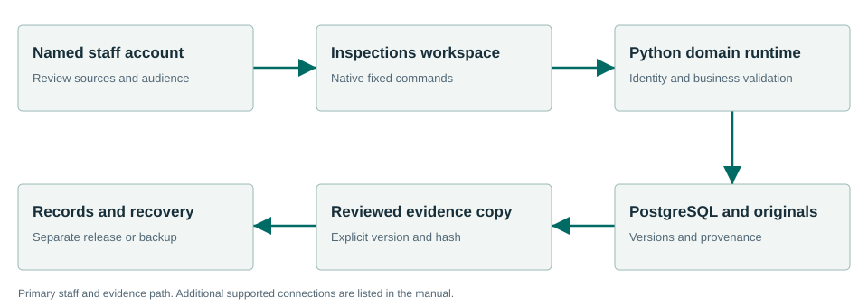

# Townlight Inspections Manual

**Townlight Beta 1** · Documentation edition 30 October 2026

## Contents

- [Using this manual](#using-this-manual)
- [Beta identity](#beta-identity)
- [First run](#first-run)
- [Daily workflow](#daily-workflow)
- [Connected workflows](#connected-workflows)
- [Architecture](#architecture)
- [Evidence limits outlines and previous cases](#evidence-limits-outlines-and-previous-cases)
- [Technical specifications](#technical-specifications)
- [Configuration and administration](#configuration-and-administration)
- [API and integration examples](#api-and-integration-examples)
- [MCP and automation boundary](#mcp-and-automation-boundary)
- [Security and permissions](#security-and-permissions)
- [Backup recovery and maintenance](#backup-recovery-and-maintenance)
- [Troubleshooting](#troubleshooting)
- [Verified workflows and limits](#verified-workflows-and-limits)
- [Terms of service and license](#terms-of-service-and-license)
- [Glossary](#glossary)
- [Alphabetical subject index](#alphabetical-subject-index)
- [Source and document control](#source-and-document-control)

## Using this manual

Townlight Inspections helps inspectors and authorized reviewing staff. Inspections retains original evidence, supplied observations and optional configured photo/audio analysis, then supports reviewed case workpapers and a separate Records copy. Automatic output is a draft for inspector review.

Staff should begin with First run and Daily workflow. Administrators should also read Architecture, Technical specifications, Configuration, Security and Recovery. Developers should use the exact API/data dictionary and examples. The table of contents and alphabetical subject index link to the relevant sections in the HTML edition; the PDF preserves headings and searchable text. An editable Word edition is included with the same documentation companion.

## Beta identity

| Identity | Value |
| --- | --- |
| Public documentation identity | Townlight Beta 1 |
| Installer version | 1.6.0.1 |
| Product component | civicinspect 0.3.0+dev.1 |
| Native desktop source version | 1.6.0-1 |
| Candidate MSI SHA256 | `98bcdef11ebdf5c767f620c904ff49f85115fde3b5c23f62703b111e645aaf86` |
| Corresponding-source SHA256 | `84a23e1297e42d17b16cfc9e51b2dd78bc46414c0de8ad7ebd2466c1a409d06b` |
| Current owned software license | AGPL-3.0-only |
| Supported acceptance profile | Windows x64 fresh install; inspections-preview; separate Station configuration |


“Townlight Beta 1” identifies this coordinated beta delivery. It does not renumber the installer, native binary, Python packages or historical receipts. Component versions may differ. This documentation is a later companion to unchanged signed bytes, not a rebuilt installer. Historical release pages and manuals describe their own versions and are not the download instructions for this private candidate.

## First run

1. Obtain the identified signed private candidate and its corresponding-source companion from the beta coordinator. The landing pages in this documentation are not an installer download service.
2. On the intended fresh Windows test installation, verify the MSI hash and publisher signature before installing. Preserve unrelated profiles and recovery material. This candidate has fresh-install acceptance; historical in-place upgrades are unverified.
3. Launch Townlight under the intended named Windows account. Choose the storage folders. Select **Townlight Inspections candidate** (`inspections-preview`) for all eight desktop products. A narrower default selection will not expose all workspaces.
4. Enter the city profile, time zone and contacts. Create the first named local administrator, sign in and choose protected backup storage. **Continue without local AI** is valid for the deterministic workflows.
5. Run Health Check and wait for readiness. Open Townlight. In System Health select **Finish Records Migration** to activate the canonical Python/PostgreSQL runtime. Do not fabricate migration receipts or seed accounts.
6. Create named staff through Settings. Import authorized sources using each product’s source library. All examples in this package are synthetic; they are not municipal authority.
7. Provision Station separately if it is part of the beta exercise. Selecting the desktop composition does not start or configure Station. Configure vision explicitly only if automatic photo drafting is selected.

## Daily workflow

<a name="workflow-1"></a>

### 1. Create the case

Enter the property/case context and inspector observations. Keep staff-only notes and identifiers in their intended fields. Save before moving away from the workspace.

<a name="workflow-2"></a>

### 2. Retain originals

Add original supported files using the existing evidence control. Inspect the filename, size and retained hash. Preserve originals separately from any derivative draft.

<a name="workflow-3"></a>

### 3. Choose supplied or automatic text

Use supplied photo observations and a supplied voice summary for deterministic work. If configured, Analyse originals calls the image-capable provider and bundled audio transcriber. Read unavailable/failed results as such; do not label supplied text automatic.

<a name="workflow-4"></a>

### 4. Review the analysis and citations

Compare automatic wording to the original evidence. Correct errors, uncertainty and Code citations. A model output is neither an official finding nor a notice.

<a name="workflow-5"></a>

### 5. Save and record review

Save the case and explicitly record inspector/staff review of that revision. Later edits create a draft requiring renewed review. Retain the case history.

<a name="workflow-6"></a>

### 6. Prepare the Records copy

Separately edit and review the public summary. Preview the Records copy and confirm that private observations, property/address detail and staff notes are excluded according to its contract.

<a name="workflow-7"></a>

### 7. Hand off exact bytes

Attach the reviewed copy to an existing Records request. Inspect its attachment/hash in Records. Attachment does not issue an enforcement action or approve a public-records response.

### Working safely

Use your own named account and save before leaving a screen. A saved draft is durable; unsaved form text may not be. If a write has an unknown result, reopen its record before repeating it.

Read source jurisdiction, dates, citation, version and visibility. A copied source hash identifies exact bytes, not their legal applicability. If a source changes or permission is removed, resolve the source problem rather than substituting stale cached content.

Keep originals and derivatives separate. Review the intended audience before export. A public summary excludes private fields only through the applicable copy contract and your review. A renamed private packet is still private content.

Drafting, review, approval, attachment, export, fulfillment and publication are separate operations. A Townlight workpaper does not itself adopt law, issue a permit, impose a fine or release a records response. The responsible staff member records the applicable decision.

## Connected workflows

Consumes cited Code and Core contracts; supplies a reviewed copy to Records. It does not imply an automatic permit-system or enforcement-system writeback.


| Direction | Material |
| --- | --- |
| Input | Inspector-supplied text, original supported photographs or audio, a configured image-capable provider when photo analysis is selected, and permitted Code authority. |
| Output | Retained evidence with provenance, editable automatic drafts where configured, reviewed cases and exact audience-specific packets. |


### Product boundary

The bundled Whistle CPU engine executes raw-audio transcription. Automatic photo analysis requires explicit vision configuration; missing configuration reports unavailable. Synthetic execution proves that adapters run, not field recognition accuracy. No official citation/fine issuance, inspection scheduling or enforcement-system writeback is provided.

## Architecture



The drawing shows the principal staff/evidence path. Native commands carry trusted identity to Python business services; PostgreSQL and retained original files hold durable state. A downstream copy does not silently transfer decision authority. Station has its own configured authority/media boundary, database and mutable files. The connected-workflow text supplies the drawing’s reading order and accessibility alternative.

## Evidence limits outlines and previous cases

### Select supported original files

The retained-original contract accepts the following MIME types, up to **10,000,000 bytes per original**. This is a decimal byte limit, not 10 MiB. An unsupported type or oversized file is refused; preserve the original outside the import and choose a supported derivative deliberately rather than changing its filename to disguise the type.

| Material | Accepted MIME types |
| --- | --- |
| Photographs | `image/jpeg`, `image/png`, `image/webp` |
| Audio | `audio/webm`, `audio/ogg`, `audio/wav`, `audio/mpeg`, `audio/mp4` |
| Plain text | `text/plain` |
| Document | `application/pdf` |

The case input bounds evidence to ten items; the browser's upload-body guard can be more restrictive when encoding/combining files. Read the actual refusal and reduce the selected batch rather than assuming the per-file limit guarantees the entire request will fit. Accepted retention of text/PDF does not promise photo analysis of that format. Configure an image-capable vision model for photographs. Whistle handles supported raw audio when provisioned; TextFlowKit is a separately configured alternative. Missing configuration is unavailable, not a fabricated successful analysis.

Retain the original filename, MIME type, byte count and SHA256. Compare generated observations/transcript with the evidence, correct the draft and record review of the saved case revision. Supplied photo observations or a supplied voice summary must remain labeled supplied text.

### Find earlier retained cases

Use the existing repeat-case lookup or authenticated `POST /desktop/v1/inspections/repeat-cases` with:

```json
{"property_reference":"Synthetic parcel A"}
```

Use the same property reference as the saved synthetic case. The mounted implementation matches the normalized property reference against saved case heads, verifies each revision hash and returns up to 50 entries with entity/revision identity, title and review state, plus `sample_data: false`. Empty results mean no matching retained cases in this store. This is separate from the lower-level `civicinspect.case_lookup.lookup_repeat_cases` helper, which returns sample context and is not the mounted saved-case query. Neither route queries an external enforcement system. Keep any real prior case identity and facts separate from a model's proposed narrative. No GIS capture or external enforcement-system connection is implied.

### Prepare an outline for review

The mounted `POST /desktop/v1/inspections/notice-draft` accepts the same `InspectionInput` shape as the saved workflow, not an arbitrary notice recipient or enforcement command. For example:

```json
{"title":"Synthetic review","property_reference":"Synthetic parcel A","inspection_reference":"SYN-001","dataset_kind":"fictional","inspector_notes":"Synthetic loose panel observed","photo_observations":["Synthetic panel appears loose"],"voice_notes":"Inspector supplied summary"}
```

Inspect the returned draft/outline and its limitations. The lower-level `civicinspect.notice_draft.draft_notice` takes case identity, property reference, violation type and supplied observations. This source helper supplies a reviewable outline; it does not issue a citation, serve notice, choose an official fine or make an enforcement determination. Where no native button exists, technical staff use the current authenticated API rather than an invented screen.

Revise the saved case's `notice_draft` only after checking the actual evidence and applicable Code source. Save and record review again; a new revision does not inherit the previous review. The staff packet and separately reviewed Records copy retain their existing audience/exclusion rules. A drafted outline is neither a Records release nor proof that a notice was delivered.

Source contracts: `civicinspect/media_analysis.py`, `case_lookup.py`, `notice_draft.py`, workflow models and `civicsuite_runtime/inspections_bridge.py`.


## Technical specifications
### Runtime and storage

The accepted package targets **Windows x64 fresh installation**. Its native shell uses **Rust 2021, Tauri 2 and Microsoft WebView2**; browser assets are JavaScript built with **Vite 8.1.6**. This describes the native desktop frontend; Station has a separate React operator, specified below or in its product manual. Canonical business workflows use bundled **CPython 3.13.5, FastAPI, Pydantic, SQLAlchemy and Alembic**, with **PostgreSQL 17 / PostGIS** and managed original files. The installed runtime tested here contains FastAPI 0.162.0. Package minimum Python requirements can differ from the bundled executable; the metadata reference preserves both. No stack rewrite is implied by the beta label.

The native transport is fixed to loopback `127.0.0.1:15480`; PostgreSQL uses the configured local runtime port (default `15432`). Optional local model service defaults to `127.0.0.1:15434`. Those are deployment defaults, not internet endpoints. The runtime has health, module and readiness endpoints; readiness is stronger than process existence. The task queue is the existing local Core task infrastructure, not an assertion that a separate Redis service is required for this desktop composition.

The default native profile is `%LOCALAPPDATA%\CivicSuite`; the historical directory name remains part of compatibility. Do not rename it to Townlight. A configured `TOWNLIGHT_PROFILE_ROOT` must be absolute. Local configuration and secrets live under that profile; protected managed files and database state must be backed up coherently. Source/runtime identity is distinct from a product’s display label.

### Data and consistency

Original evidence files and hashes; media analysis records; observations and voice summaries; Code citations; case revisions; review records; private packets and separately edited Records copies.

Versioned saves use expected prior revision identifiers where defined. Reopen and reconcile on conflict. Exact exports and handoffs use source IDs, current visibility, revision and SHA256. Review belongs to the saved revision and does not transfer silently to edited text. Database changes use the owning product’s migrations; a request or readiness check is not an authorization to mutate schema.

### Capacity and platform statements

This beta has synthetic single-profile workflow evidence. It does not have a published benchmark for concurrent staff capacity, minimum RAM/CPU, large-source limits or a field SLA. Do not turn a developer machine’s specification into a supported minimum. Installer size is 2,092,122,112 bytes before installation; allow additional disk for extracted runtime, database, originals, exports, media and backups. Select equipment/storage after sizing those actual workloads.

The exact [runtime payload lock](docs/beta-1/reference/runtime-payload-lock.json) records pinned files, sizes and hashes. The [component metadata](docs/beta-1/reference/component-metadata.json) records shipped dependency declarations. These references are more precise than a manually copied dependency list. Third-party and historical license notices must accompany their matching payloads.

## Configuration and administration
### Native deployment configuration

Use Setup, Settings and System Health for supported staff operation. Administrators provision folders, backup storage, named accounts and the city profile. Select `inspections-preview` for the full eight-workspace desktop. Station remains a separate service boundary. Do not use a standalone product’s demo server as a substitute for the installed workspace.

Technical deployments use `TOWNLIGHT_PRODUCT_PROFILE`, `TOWNLIGHT_PROFILE_ROOT`, `DATABASE_URL`, `CIVICSUITE_RUNTIME_PORT`, `PORTAL_MODE` and the runtime-managed secret files. Treat database URLs and native session proofs as secrets. The installed native domain runtime explicitly refuses non-loopback binding. `PORTAL_MODE=private` is the accepted posture; changing it does not by itself commission an internet portal, authentication provider or reverse proxy.

The isolated documentation exporter sets a fictional profile and unusable synthetic database origin only to read schemas; those values are not deployment configuration. Keep deployment values in the intended process/account scope. An already-running process does not automatically inherit later environment edits.

### Optional media analysis configuration

`CIVICINSPECT_VISION_PROVIDER` accepts `ollama`, `openai` or `anthropic`. Select an actually image-capable model through `CIVICINSPECT_VISION_MODEL`; an Ollama endpoint may use `CIVICINSPECT_VISION_BASE_URL`. `CIVICINSPECT_VISION_THINK` accepts true/false/low/medium/high where that configured adapter uses it. Keep provider credentials in protected deployment configuration, never in a source bundle. Missing vision configuration returns unavailable rather than invented observations.

`CIVICINSPECT_TRANSCRIBER` selects `whistle` or `textflowkit`; the installed candidate provisions the bundled Whistle CPU path. The owning transcriber assets and retained notices must stay with it. A provider result remains an editable draft with original evidence retained. The separate TextFlowKit MCP adapter is not an automatically enabled Townlight server.

## API and integration examples
### Native command example

The following JavaScript belongs in the existing trusted Townlight frontend/development environment with `invoke` imported from `@tauri-apps/api/core`. It is not a command for an arbitrary web page or an instruction for nontechnical staff. IDs must come from records created in an isolated synthetic exercise.

```javascript
import { invoke } from '@tauri-apps/api/core';
const result = await invoke('inspections_domain_request', {request: {operation: 'cases', offset: 0}});
console.log(result);
```

### Trusted local HTTP example

An administrator/developer can inspect an already-configured isolated runtime from a trusted local process. This PowerShell example reads the signed-in synthetic profile’s existing proof into memory; it does not create a user, seed a session, reveal the proof in output or bypass a permission check. Do not use real city data in development examples. A read response does not prove approval or publication.

```powershell
$profilePath = Join-Path $env:LOCALAPPDATA 'CivicSuite'
$sessionPath = Join-Path $profilePath 'config\local-session.json'
$session = Get-Content -LiteralPath $sessionPath -Raw | ConvertFrom-Json
$headers = @{ 'X-Townlight-Session' = $session.session_hash }
Invoke-RestMethod -Uri 'http://127.0.0.1:15480/desktop/v1/inspections/evidence/supported-types' -Headers $headers
Remove-Variable session, headers
```

### A synthetic write with subsequent readback

This example demonstrates the existing Meetings HTTP contract in an isolated exercise. It is intentionally fictional. It does not start a service. Its authentication setup is included so it can be run independently under the signed-in synthetic account. If a write times out, inspect current records before repeating it.

```powershell
$profilePath = Join-Path $env:LOCALAPPDATA 'CivicSuite'
$sessionPath = Join-Path $profilePath 'config/local-session.json'
$session = Get-Content -LiteralPath $sessionPath -Raw | ConvertFrom-Json
$headers = @{ 'X-Townlight-Session' = $session.session_hash }
$body = @{
  title = 'Synthetic documentation exercise'
  scheduled_start = '2026-11-05T18:00:00-07:00'
  location = 'Synthetic room'
  meeting_type = 'regular'
} | ConvertTo-Json
$meeting = Invoke-RestMethod -Method Post `
  -Uri 'http://127.0.0.1:15480/desktop/v1/meetings/meetings' `
  -Headers $headers -ContentType 'application/json' -Body $body
Invoke-RestMethod `
  -Uri ('http://127.0.0.1:15480/desktop/v1/meetings/meetings/' + $meeting.id) `
  -Headers $headers
Remove-Variable session, headers
```

This write requires Meetings to be enabled and the signed-in staff role to permit it. It is a cross-suite integration example; for this product’s request models, use the complete technical reference below.

### Complete technical contract

Read the [Inspections API reference](docs/beta-1/api/inspections.html) for every documented operation, request field, constraint, response declaration and source supplement. Download the [OpenAPI JSON](docs/beta-1/api/inspections-openapi.json) for tools. For Station this is the suite-side schema only; its separate service contract is documented in the API supplement. The [reference directory](docs/beta-1/reference/index.html) includes configuration/source inventories, dependency declarations, native command contracts, MCP signatures and candidate evidence.

## MCP and automation boundary

No direct product MCP server is exposed by the accepted Townlight desktop or Station boundary. Do not configure an invented `townlight mcp` command or assume an AI client has staff permissions. The integration surfaces for this beta are native IPC, the documented HTTP APIs, source bundle imports, exact exports and the existing Station CLI.

The bundled transcription code includes a **TextFlowKit MCP adapter** as a separate source capability. It offers job-based `transcribe_media`, `get_transcript`, `list_jobs`, `get_job_status` and `export_transcript`, and additional tools declared in that adapter. It uses stdio first and optional Streamable HTTP, with the MCP SDK as an optional extra. It is not automatically launched, authenticated as Townlight staff or accepted as a Townlight product MCP deployment. This documentation does not add such a service.

For a transcription client already provisioned separately, an illustrative tool call is:

```json
{"name":"get_job_status","arguments":{"job_id":"synthetic-existing-job-id"}}
```

Use a job ID returned by that transcription service. This example does not create a Townlight record or bypass its review/Records handoff. The exact optional adapter tool signatures are supplied in the [MCP source reference](docs/beta-1/reference/mcp.html). Station meeting capture does not become live speech recognition because this optional donor adapter exists.

## Security and permissions


Use your own named account and save before leaving a screen. A saved draft is durable; unsaved form text may not be. If a write has an unknown result, reopen its record before repeating it.

Read source jurisdiction, dates, citation, version and visibility. A copied source hash identifies exact bytes, not their legal applicability. If a source changes or permission is removed, resolve the source problem rather than substituting stale cached content.

Keep originals and derivatives separate. Review the intended audience before export. A public summary excludes private fields only through the applicable copy contract and your review. A renamed private packet is still private content.

Drafting, review, approval, attachment, export, fulfillment and publication are separate operations. A Townlight workpaper does not itself adopt law, issue a permit, impose a fine or release a records response. The responsible staff member records the applicable decision.

The native session is validated and mapped to a persisted SQL identity. An editable actor/reviewer label is not authentication. Product/module permissions and source visibility apply at the server boundary. Revoked/unavailable authority fails closed for new Station operations; a previous permission result is not a perpetual authorization.

Use protected local folders, account permissions and credential storage. Never include the native session file, database passwords, provider keys or unredacted support bundles in a public issue or generated public documentation. A local public view is not automatically a secured internet deployment. Keep network exposure and real equipment acceptance specific to the chosen beta site.

## Backup recovery and maintenance

Save work and use Core’s canonical **Backup Now** before maintenance. That operation stops writers. Preserve the coherent profile/database/document backup and its receipt, then use **Start** to resume. A source export is not a full backup.

Use **Restore Latest Backup** through the supported controls. If the result says **Restore needs service start**, use **Start**, then **Check**, and reopen a known record. Do not repeat restore merely because services need to start. The fresh-profile acceptance verified that a fulfilled request survived restore and a post-backup marker did not.

Keep Station’s dedicated database and media evidence together in its own backup. Core’s native-profile backup must not be assumed to include an external Station data directory. Stop writers during a coordinated backup. Preserve failed media attempts and logs.

On failure, record the time, selected composition, component/installer versions and exact message. Check System Health for stopped, starting, ready or failed dependencies. Use the existing Retry control after readiness; do not create duplicate business records to refresh a stale view. Share only a redacted diagnostic bundle. Preserve secrets, original evidence, recovery material and unrelated installations.

## Troubleshooting

| Symptom | Likely meaning | Next action |
| --- | --- | --- |
| Workspace absent | Wrong product composition or unavailable canonical runtime. | Check selected composition; activate through Finish Records Migration; wait for readiness. |
| Cannot sign in / 401 | Missing or expired named account session. | Sign in normally; reopen a Station launch ticket if applicable. |
| Permission denied / 403 | Account, module, source or browser-origin permission. | Ask the authorized administrator to inspect the intended permission; do not invent role headers. |
| Save conflict / 409 | The saved revision, expected source hash or lifecycle changed. | Keep edits, reopen current state and reconcile deliberately. |
| Invalid input / 422 | Required field, format, geometry, source envelope or state is invalid. | Read the field detail and correct the input/source; preserve originals. |
| Service unavailable / 503 | Database, schema, connected source or configuration unavailable. | Inspect System Health and the named dependency. Preserve work; retry only after readiness. |
| Export refused | Missing exact review, approval, audience or source authorization. | Read the refusal and complete the owning product’s explicit decision. |
| Restore needs service start | The snapshot was restored but services have not resumed. | Use Start, then Check and verify a saved record; do not blindly repeat restore. |
| Photo analysis unavailable | No configured image-capable vision service. | Use supplied observations or have an administrator configure the existing adapter. |
| Automatic text is incorrect | Model recognition is uncertain or wrong. | Compare original evidence, edit and record inspector review before any official use. |


## Verified workflows and limits

| Product | Recorded result | Precisely exercised |
| --- | --- | --- |
| Inspections | PASS | Retained original/hash, supplied observations and voice summary, saved/reviewed case/readback, separate exact Records copy and private handoff; address exclusion; native workspace. |


These results come from the identified signed candidate’s fresh normal-profile Sandbox exercise: real native IPC/HTTP/PostgreSQL and selected headless controls. All accounts, source bundles and media were synthetic. The guest install/uninstall and recovery passed, and the owned Sandbox stopped. No host installed application or standalone CivicCast was changed. This documentation task reuses those receipts; it does not claim a new software acceptance run.

The [workflow matrix](docs/beta-1/reference/workflow-matrix.json) identifies raw receipt filenames. The [evidence index](docs/beta-1/reference/sandbox-evidence-index.json) retains their original hashes; raw receipts remain in the private beta handoff rather than being silently republished with the documentation site.

The limits remain: actual city field acceptance and equipment/network commissioning; Station automatic provisioning/SCM commissioning; every UI/role combination; field recognition accuracy; and historical in-place upgrades are not certified. They are not five invented feature requirements. Fresh-install controlled beta handoff remains the accepted scope. This package makes no city-deployment, publication or general-availability claim.

## Terms of service and license

### Scope and status

These terms describe the Townlight Beta 1 software and this documentation package. This is a locally prepared private beta, not a hosted-service subscription, a city deployment agreement or a public release. No uptime commitment, support response time, indemnity, data-processing agreement or paid service is created by these documents. A separate signed agreement, if any, governs services it actually provides.

### Software license and rights

Current Townlight-owned distributions identified in this candidate use **AGPL-3.0-only**. The full license is supplied with this documentation and with the source companion. The license governs rights to run, copy, modify and convey the covered software; these operational terms do not add restrictions to those rights. Historical grants and dependency licenses retain their own terms. CivicCast remains a separate product and is not relicensed by this documentation work.

When conveying covered software, retain applicable notices and provide the corresponding source and installation/build information required by the license. For a modified version supporting remote network interaction, follow section 13’s source-offer requirement. The companion archive identifies the source for this candidate; a link to a different public branch is not a substitute for the matching source. Read the supplied license for the complete conditions. See the [GNU license reference](https://www.gnu.org/licenses/agpl-3.0.html) and [GNU licensing FAQ](https://www.gnu.org/licenses/gpl-faq.en.html).

### Data ownership and access

Importing a document does not transfer its ownership or grant permission to publish it. The operating organization controls its accounts, access decisions, lawful source use, retention and review/release policy. Keep resident information, credentials, private notes and restricted evidence in their authorized locations. Documentation examples contain fictional data. No real city account, credential or record is required to exercise these examples in an isolated test environment.

### Local operation and external processors

The accepted beta workflow is local and uses named staff accounts. Station has separate storage and credentials. Configure backup destinations and optional model/network providers deliberately. A configured external provider may receive submitted prompts, images or audio according to that configuration and provider’s terms; this documentation does not promise that every optional configuration is offline. An email outbox or local public view does not establish external delivery or an internet deployment. This static documentation site has no analytics, account collection or remote font dependency.

### Staff decisions and source applicability

Staff verify the jurisdiction, source currency, permissions, citations and proposed audience. Model output and generated guidance require review. No draft is automatically an official legal interpretation, zoning determination, permit approval, fee assessment, enforcement notice or records-release decision. Official permit fee authority remains with the adopted source and responsible organization; imported amounts do not become a new authoritative calculation.

### Beta operation and recovery

Use the identified candidate in its supported fresh-install scope. Preserve backups and original evidence. Test physical equipment and chosen network/service configuration before relying on them. The supplied acceptance describes selected synthetic workflows, not every screen, vendor, field condition or upgrade. Operators decide whether a particular deployment meets their own operational obligations.

### Warranty and liability

The covered software’s warranty and liability conditions are those in sections 15–17 of the supplied AGPL and any applicable separate written undertaking. This documentation creates no additional warranty or limitation beyond those terms. Third-party software is subject to its retained license notices. Nothing here removes rights that applicable law makes nonwaivable.

### Support and incident reporting

Use the project’s existing SUPPORT and SECURITY guidance for its matching repository. Report reproducible behavior with the version, operation and redacted logs. Do not put credentials, resident records or unredacted evidence in a public issue. Coordinate sensitive reports through the channel designated in SECURITY. No new support address or service commitment is invented here.

### Ending a beta exercise and document changes

When an organization ends testing, it controls retention/export and removes access according to its policy. Uninstall may retain data; back up and inspect the selected removal options. Ending an exercise does not revoke rights already granted by AGPL. Later software/documentation versions must identify their changed candidate and scope; historical receipts retain their original identities. These terms do not claim that a city has accepted a contract merely by reading a manual.

## Glossary

| Term | Meaning |
| --- | --- |
| Approval | An explicit authorized decision on the saved text/artifact. It is separate from saving or attachment. |
| Canonical record | The owning product’s retained identity and saved version, rather than an editable copied label. |
| Composition | The selected set of desktop modules; inspections-preview exposes the eight staff products. |
| Corresponding source | The source/build material matching the delivered covered program, subject to its license. |
| Derivative / Records copy | A separately prepared document with its own intended audience and hash. |
| Hash / SHA256 | A fingerprint of exact bytes. It detects change; it does not establish legal authority. |
| Idempotency | Repeating the same identified request has the same intended effect; changing its payload can be refused. |
| IPC | The native desktop command boundary between its browser interface and Rust host. |
| MCP | Model Context Protocol; no direct Townlight product server is enabled by this beta. |
| Original | Retained source bytes. A reviewed derivative does not replace them. |
| Provenance | Source, version, date, actor and relationship information retained with evidence. |
| Revision | An immutable saved version. Later edits do not inherit an earlier review automatically. |
| Snapshot | A fixed audience-specific copy tied to a source/reviewed revision. |
| Station | Townlight’s separate media boundary using a pinned CivicCast-derived engine; standalone CivicCast remains separate. |


## Alphabetical subject index

- **Accounts and authentication** — [Security and permissions](#security-and-permissions).
- **AGPL and source** — [Terms of service and license](#terms-of-service-and-license).
- **API contracts** — [API and integration examples](#api-and-integration-examples).
- **Architecture** — [Architecture](#architecture).
- **Backup** — [Backup recovery and maintenance](#backup-recovery-and-maintenance).
- **Beta version** — [Beta identity](#beta-identity).
- **Configuration** — [Configuration and administration](#configuration-and-administration).
- **Evidence and acceptance** — [Verified workflows and limits](#verified-workflows-and-limits).
- **Fees and official decisions** — [Terms of service and license](#terms-of-service-and-license).
- **First run** — [First run](#first-run).
- **Handoffs and audience** — [Connected workflows](#connected-workflows).
- **MCP** — [MCP and automation boundary](#mcp-and-automation-boundary).
- **Originals and provenance** — [Security and permissions](#security-and-permissions).
- **Recovery** — [Backup recovery and maintenance](#backup-recovery-and-maintenance).
- **Staff procedures** — [Daily workflow](#daily-workflow).
- **Station configuration** — [Configuration and administration](#configuration-and-administration).
- **Technical stack** — [Technical specifications](#technical-specifications).
- **Troubleshooting** — [Troubleshooting](#troubleshooting).

### Operating subject links

- **Evidence limits outlines and previous cases** — [Evidence limits outlines and previous cases](#evidence-limits-outlines-and-previous-cases).
- **Find earlier retained cases** — [Find earlier retained cases](#find-earlier-retained-cases).
- **Prepare an outline for review** — [Prepare an outline for review](#prepare-an-outline-for-review).
- **Select supported original files** — [Select supported original files](#select-supported-original-files).

## Source and document control

This edition is authored from the immutable corresponding-source companion, the generated installed-domain schema and the retained workflow receipts. The current software versions and signed artifacts are unchanged. Public historical pages are not synchronized or published by this local documentation task.

### Workflow subject index

- **Choose supplied or automatic text** — [Daily workflow, step 3](#workflow-3).
- **Create the case** — [Daily workflow, step 1](#workflow-1).
- **Hand off exact bytes** — [Daily workflow, step 7](#workflow-7).
- **Prepare the Records copy** — [Daily workflow, step 6](#workflow-6).
- **Retain originals** — [Daily workflow, step 2](#workflow-2).
- **Review the analysis and citations** — [Daily workflow, step 4](#workflow-4).
- **Save and record review** — [Daily workflow, step 5](#workflow-5).

- [Source inventory and file hashes](docs/beta-1/reference/source-inventory.json)
- [All component metadata](docs/beta-1/reference/component-metadata.json)
- [Installed domain OpenAPI](docs/beta-1/reference/desktop-domain-openapi.json)
- [Workflow matrix](docs/beta-1/reference/workflow-matrix.json)
- [Full AGPL text](docs/beta-1/reference/AGPL-3.0.txt)
